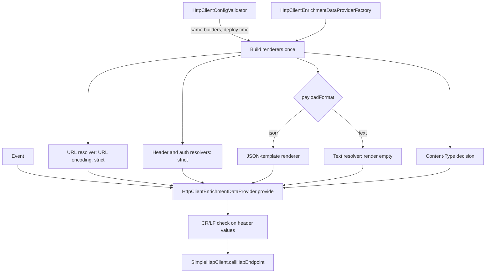

# Escape HTTP Enrichment Template Values - Plan

---

## Goal Capsule

- **Objective:** An alert that reaches the Enrichment node's HTTP Client provider always produces either a well-formed request or a clear, located error, whatever its field values contain.
- **Means:** zephflow-core's template layer gains format-aware rendering chosen by the caller and fixed when the template is loaded (KTD1, KTD2, KTD3); the zephflow-plus HTTP Client provider uses it for its URL, headers, auth and body.
- **Issue of record:** FLE-3874 (https://linear.app/fleak/issue/FLE-3874/escape-template-values-for-json-payloads-and-urls).
- **Authority:** Product Contract Requirements win on behavior; KTDs win on mechanism; a unit overrides neither.
- **Execution profile:** two PRs in two repositories (KTD9). PR1 zephflow-core, PR2 zephflow-plus (needs a published zephflow-core release containing PR1).
- **Stop conditions:** stop and report if `./gradlew :lib:goldenTest` in zephflow-core changes any expected output, or if any existing caller of `TemplatePlaceholderResolver` other than the HTTP Client provider would change behavior.
- **Who finishes:** the implementing agent builds and verifies both PRs. Three maintainer actions outside this work follow before running pipelines get the fix: publishing a zephflow-core release containing PR1, publishing a zephflow-plus release containing PR2, and the dynamicapi version bump listed under Deferred to Follow-Up Work.

---

## Product Contract

### Summary

The HTTP Client provider gets an explicit body format (`payloadFormat`, default `json`). JSON bodies are generated from a parsed JSON template, so they are valid by construction. URL values are percent-encoded after the host. Missing URL, header and auth values, and header values containing line breaks, fail the event with an error that names the field and not the value.

### Problem Frame

The HTTP Client provider inserts event values into its templates verbatim (`TemplatePlaceholderResolver.resolvePlaceholders`). A Snort rule name containing `"` turns the JSON body invalid, and Slack answers HTTP 400. A value containing `&`, `#` or a space changes or breaks the URL. A single missing field makes the whole template resolve to null, so the provider sends an empty body, or sends the literal `null` in a header (`Authorization: Bearer null`). Every one of these fails the event, and a failed enrichment sends the alert to the failure path instead of downstream. In the NESIC POV the provider sends Slack alerts and looks up Meraki client details, and both carry arbitrary log content.

### Requirements

**JSON body**
- R1. With `payloadFormat: json`, the request body is valid JSON for any event field content.
- R2. A JSON payload template that is not valid JSON is a configuration error at deploy time, located at `payloadTemplate`.
- R3. A JSON string in the template that consists of exactly one placeholder renders the value with its native JSON type (string, number, boolean, object, array); a missing value renders as JSON `null`.
- R4. A JSON string that mixes literal text and placeholders renders as a JSON string; a missing value contributes an empty string.

**Body format and Content-Type**
- R5. `payloadFormat` accepts `json` or `text` and defaults to `json`; `text` sends the rendered template verbatim, with missing values rendered as empty strings.
- R6. With `payloadFormat: json` and a non-blank payload template, the request carries `Content-Type: application/json` unless a Content-Type header is configured, in which case the configured header is sent unchanged.
- R7. A blank or absent `payloadTemplate` means the request has no body, in either format, and no Content-Type is added.

**URL**
- R8. Placeholder values after the URL's scheme and host are percent-encoded so they cannot change the URL's structure; a placeholder that forms the scheme, the host or the whole URL is inserted verbatim.
- R9. A URL placeholder with no value fails the event with an error naming `urlTemplate` and the placeholder expression.

**Headers and auth**
- R10. A header or auth (basic username, basic password, bearer token) placeholder with no value fails the event with an error naming the header or auth field and the placeholder expression.
- R11. A rendered header or auth value containing CR or LF fails the event with an error naming the header and not containing the value.

**Compatibility**
- R12. Every other caller of `TemplatePlaceholderResolver` keeps its current behavior, and the zephflow-core golden fixtures produce unchanged output.
- R13. dynamicapi passes `payloadFormat` from the Enrichment node config to zephflow-plus unchanged. `EnrichmentTranslator.translateHttpClient` already copies the whole provider map, so this holds without a code change; the dynamicapi follow-up pins it with a test.

### Key Decisions

- **A missing URL value fails the event.** Governs R9. (session-settled: user-directed — chosen over rendering an empty value: a request to the wrong endpoint is worse than an error)
- **Existing template outputs need not be preserved.** Governs R1, R3, R4, R5. (session-settled: user-directed — chosen over keeping every currently valid output unchanged: the user stated backward compatibility is not needed)
- **The body format is an explicit `payloadFormat` setting with a derived Content-Type.** Governs R5, R6. (session-settled: user-approved — chosen over inferring the format from the Content-Type header or by sniffing the template: Logstash `format`, Postman and Python requests `json=` all derive Content-Type from an explicit format, and Postman, Vector, Grafana and EventBridge let a user-set header win)
- **JSON bodies use a parsed JSON template.** Governs R1, R2, R3, R4. Complex payloads are built upstream with an eval node and inserted as `"{{$.payload}}"`. (session-settled: user-approved — chosen over scanning the template for quote positions and escaping by context: output is valid by construction and template mistakes surface at deploy time)
- **URL values follow RFC 6570's split between `{var}` and `{+var}`.** Governs R8. (session-settled: user-approved — chosen over encoding everything or nothing: values are encoded like `{var}`, a host or whole-URL placeholder is kept like `{+var}`)
- **Missing header and auth values fail the event.** Governs R10. (session-settled: user-approved — chosen over sending the literal `null`, as today)
- **Line breaks in header values are rejected, not stripped.** Governs R11. (session-settled: user-approved — chosen over silently removing CR/LF: Java HttpClient, OkHttp and Vector reject such values, and stripping hides the problem)
- **Scope is the HTTP Client provider only.** (session-settled: user-directed — chosen over also fixing the Fetch HTML provider's URL: Fetch HTML is being deleted under FLE-4010)
- **No Slack sink in this work.** (session-settled: user-directed — chosen over building a dedicated Slack sink now)

### Acceptance Examples

- AE1. Covers R1, R4. Given template `{"text": "alert: {{$.rule}}"}` and `rule = ET "MALWARE" C:\x` followed by a newline and `next`, the body parses as JSON and `text` equals `alert: ` followed by the exact rule string.
- AE2. Covers R3. Given template `{"n": "{{$.count}}", "dev": "{{$.device}}", "geo": "{{$.geo}}"}` with `count = 3`, `device = {"ip": "10.0.0.1"}` and no `geo`, the body is `{"n":3,"dev":{"ip":"10.0.0.1"},"geo":null}`.
- AE3. Covers R3. Given template `"{{$.payload}}"` and a `payload` record built by an upstream eval node, the body is that record serialized as JSON.
- AE4. Covers R8. Given `https://api.meraki.com/api/v1/networks/{{$.net}}/clients?mac={{$.mac}}` with `net = N_1/2` and `mac = a&b #c`, the URL is `https://api.meraki.com/api/v1/networks/N_1%2F2/clients?mac=a%26b%20%23c`.
- AE5. Covers R8. Given `{{$.url}}` or `https://{{$.host}}/v1`, the URL value or host is inserted unchanged.
- AE6. Covers R6, R7. Given `payloadFormat` unset, a non-blank payload template and no Content-Type header, the request carries `Content-Type: application/json`; given header `content-type: text/plain`, only that header is sent; given `payloadTemplate: ""`, the request has no body and no added header.

### Scope Boundaries

- Not built: a query-parameter key/value list for URLs (n8n/Postman style). Encoding placeholder values in the URL template covers the reported failures. Revisit if users need to build query strings with optional parameters.
- Not built: per-placeholder functions such as `| json`, `| string` or `| raw`. The one-placeholder-keeps-type rule plus upstream eval covers the known cases. Revisit when a user needs a number rendered as a JSON string.
- Not built: placeholders inside JSON object keys. They are rejected at load time (KTD2).

#### Deferred to Follow-Up Work

- dynamicapi rollout, after a zephflow-plus release containing PR2 exists. The Grid runs the zephflow-plus version dynamicapi was built with (`appserver/build.gradle`), so the fix reaches running pipelines only after this step:
  - Before the bump, query deployed HTTP Client configs for payload templates Jackson cannot parse, and fix them or tell their owners.
  - Bump `zephflowplus-commands` in `gradle/libs.versions.toml`.
  - Change `payloadTemplate` from `{{$}}` to `"{{$}}"` in `ExecutionPreparedRuntimeTest`, `McpGraphReadHttpIntegrationTest` and `src/test/resources/dags/execution_managed_http_and_hec.json`, which run real HTTP Client enrichments.
  - Add a `payloadFormat` pass-through assertion to `EnrichmentTranslatorTest` (R13).
- webapp: a `payloadFormat` dropdown in the HTTP Client form. The zod schema (`webapp/src/api/fleak/schemas/common.ts`, `EnrichmentHttpClientProviderSchema`) strips unknown keys, so a UI edit resets `payloadFormat` to the default `json` until the dropdown exists.
- zephflow-doc: document `payloadFormat`, the JSON-template rules and URL encoding in the Enrichment node docs (`docs/workflowbuilder/nodes` in `fleaktech/zephflow-doc`), which copilot and MCP read.
- Enrichment failure dropping the event: FLE-3877.
- SQL injection in JDBC and BigQuery enrichment: FLE-3875.
- Fetch HTML provider removal: FLE-4010.
- s3read `fileName` and SMTP sink template issues (bucket switching, comma-split recipients, unescaped HTML bodies): neither node is reachable from the UI; needs its own ticket.

---

## Planning Contract

### Key Technical Decisions

- KTD1. **Rendering is fixed at load time.** Template parsing, JSON-tree construction, each placeholder's encoding and the Content-Type decision happen when the resolver, renderer or provider is created; per-event work only evaluates path expressions and serializes. (session-settled: user-directed — chosen over inspecting values per event, such as parsing string values as JSON: per-event parsing costs performance)
- KTD2. **The JSON-template renderer lives in zephflow-core**, in `lib/src/main/java/io/fleak/zephflow/lib/commands/` next to `TemplatePlaceholderResolver`, so the planned webhook sink and other callers can reuse it. At load time it parses the template with Jackson, walks the tree, turns every string leaf containing a placeholder into either a single-value slot (R3) or a mixed-string resolver (R4), and rejects placeholders in object keys. At render time it builds the output tree and serializes it with Jackson.
- KTD3. **`TemplatePlaceholderResolver` gains two opt-in options:** URL encoding of placeholders after the host (R8), and a missing-value policy of "return null" (today's default) or "render empty". The existing `create(...)` overloads keep both defaults, so the SMTP sink and every zephflow-plus caller other than the HTTP Client are unchanged (R12).
- KTD4. **Strict resolution reports which placeholder is missing.** The resolver offers a resolution mode that fails with an exception naming the placeholder's path expression and never the event value. The HTTP Client adds the config field name (R9, R10). The exception type reuses an existing zephflow-core exception if one fits; otherwise it is a new unchecked exception in the same package.
- KTD5. **Missing values are lenient in bodies and strict in URLs, headers and auth.** Mixed JSON strings and `text` bodies render a missing value as empty (R4, R5), matching the settled null for single-placeholder strings (R3). URLs, headers and auth fail (R9, R10) because a wrong value there misroutes or misauthenticates the request.
- KTD6. **URL encoding uses the RFC 3986 unreserved set.** `URLEncoder` output with `+` replaced by `%20`, the same as zephflow-plus `httppull/HttpPullRequests.java` path encoding. The boundary is the first `/`, `?` or `#` in the template's literal text after any `://`; placeholders after it are encoded. Before the boundary:
  - A placeholder that starts the template (`{{$.url}}`, `{{$.base}}/v1`) or is the entire authority between `://` and the boundary (`https://{{$.host}}/v1`) is inserted verbatim, per the `{+var}` decision.
  - A placeholder sharing the authority with literal host text (`https://{{$.tenant}}.api.example.com/v1`, `api.example.com:{{$.port}}`), or following literal host text in a template with no boundary (`https://api.example.com{{$.path}}`), fails the event with a strict-resolution error naming `urlTemplate` and the placeholder when its value contains `/`, `?`, `#`, `@`, `\`, `:` or whitespace. Otherwise an event value such as `evil.com#` or `@evil.com` would move the request, and its Authorization header, to another host (R8).
- KTD7. **Header checks live in zephflow-plus**, on each rendered value before the `"name: value"` strings reach `SimpleHttpClient`: configured header values, the bearer token, and the basic username and password before Base64 encoding (after encoding a line break is no longer visible). Content-Type detection compares configured header names case-insensitively.
- KTD8. **The config validator builds the same objects the factory builds**, so a JSON-template error is reported at deploy time with `ConfigurationPath` `payloadTemplate`, matching how `HttpClientConfigValidator` already calls `TemplatePlaceholderResolver.create(template, of(...))`.
- KTD9. **Two PRs, one per repository.** The changes live in two repositories, and zephflow-plus resolves `io.fleak.zephflow` from GitHub Packages, so PR2 cannot build in CI until a zephflow-core release containing PR1 is published. Local verification of PR2 runs against a zephflow-core build installed with `publishToMavenLocal`. dynamicapi needs no code change now (R13); its version bump waits on a zephflow-plus release and is deferred.

### High-Level Technical Design

Per-position rendering, all fixed when the provider is created (KTD1):

| Position | Encoding | Missing value | Bad value |
|---|---|---|---|
| URL before host boundary | verbatim | event fails (R9) | n/a |
| URL after host boundary | percent-encoded (R8) | event fails (R9) | n/a |
| Header value, auth value | verbatim | event fails (R10) | CR/LF fails (R11) |
| JSON body, single-placeholder string | native JSON value (R3) | `null` | n/a |
| JSON body, mixed string | JSON string (R4) | empty | n/a |
| Text body | verbatim (R5) | empty | n/a |

JSON template grammar, directional:

```text
template      := any JSON value (parsed once at load; invalid JSON -> config error at payloadTemplate)
object key    := literal string only (a placeholder here -> config error)
string leaf   := "{{ path }}"            -> slot: native value of path, or null when missing
               | text with {{ path }}... -> string: placeholders rendered as text, missing -> ""
               | text without {{ }}      -> literal, copied as is
other leaf    := number | boolean | null -> copied as is
render(event) := rebuild the tree with slots and strings filled in, then serialize with Jackson
```

Load-time and run-time flow:



### Assumptions

- The next zephflow-core release candidate after `v0.5.0-rc.49` is `0.5.0-rc.50`; PR2 bumps `zephflow` in `gradle/libs.versions.toml` to whatever version actually contains PR1.
- Numbers keep the JSON type `FleakData.unwrap()` gives them (`long` for integer values, `double` otherwise).
- Error messages surface through `ErrorOutput(event, e.getMessage())` (`api/src/main/java/io/fleak/zephflow/api/ScalarCommand.java`), so they must carry the field and placeholder, never values (R10, R11).

### System-Wide Impact

- Shared component: `TemplatePlaceholderResolver` is used by the zephflow-core SMTP sink and by zephflow-plus in-memory lookup, JDBC, BigQuery, s3read and LLM chat. Only opt-in options change it (KTD3); R12 holds them unchanged.
- External contract: `payloadFormat` is a new optional field on the HTTP Client provider config, read by dynamicapi (pass-through; its execution tests use `{{$}}` and need the deferred fixture update), webapp (stripped, deferred) and zephflow-doc (deferred).
- Behavior change for existing HTTP Client nodes: JSON payload templates must now be valid JSON with placeholders inside quotes. The UI's own placeholder example (`webapp/.../HttpClientFields.tsx`, `"payload": {{$}}`) becomes invalid and should read `"payload": "{{$}}"` in the webapp follow-up.

### Risks & Dependencies

- PR2 depends on a published zephflow-core release. Until a maintainer publishes it, PR2 stays open with CI unable to resolve the new version.
- A deployed HTTP Client node whose payload template is not valid JSON fails at provider creation as soon as its job starts on the new zephflow-plus runtime, including a restart without redeploy, not only at its next deploy. This was accepted with the no-compatibility decision; the pre-bump query in the dynamicapi follow-up finds such nodes first, and the error says how to fix the template (placeholders go inside quotes).
- Accepted, not built: a template whose whole URL or whole host comes from an event field (AE5) can send configured credentials to any public host the event names, because `SecurityUtils.isUrlAllowed` only rejects private and loopback addresses. This follows the settled `{+var}` decision; revisit with a host allowlist if users attach static auth to such templates.

---

## Implementation Units

### PR1: zephflow-core template rendering

Waits on: nothing.

### U1. Resolver URL encoding, missing-value policy and strict resolution

- **Goal:** `TemplatePlaceholderResolver` can encode URL values, render missing values as empty, and report a missing placeholder by expression, without changing default behavior.
- **Requirements:** R8, R9, R10, R12; KTD1, KTD3, KTD4, KTD6.
- **Dependencies:** none.
- **Files:**
  - `lib/src/main/java/io/fleak/zephflow/lib/commands/TemplatePlaceholderResolver.java`
  - `lib/src/test/java/io/fleak/zephflow/lib/commands/TemplatePlaceholderResolverTest.java` (unit seam: catches encoding, boundary and missing-value rules; misses how the HTTP Client wires them)
- **Approach:**
  1. Add the URL-encoding option and the missing-value option as creation-time settings; compute each placeholder's encoding once at creation (KTD1, KTD6).
  2. Keep every existing `create(...)` overload's behavior: verbatim and return null.
  3. Add strict resolution that throws the KTD4 exception naming the placeholder expression.
- **Patterns to follow:** existing `create(template, ConfigurationPath)` error locating; `httppull/HttpPullRequests.java` in zephflow-plus for `URLEncoder` plus `%20`.
- **Test scenarios:**
  - URL mode encodes `a&b=c #d e/f` after the host as `a%26b%3Dc%20%23d%20e%2Ff`, in both path and query positions.
  - URL mode leaves `{{$.url}}`, `https://{{$.host}}/v1` and `{{$.base}}/v1` placeholders before the boundary verbatim, and encodes the same value when it appears after the boundary.
  - `https://{{$.t}}.api.example.com/v1` with `t = evil.com#` fails with an error naming the placeholder; with `t = acme` it renders `https://acme.api.example.com/v1`.
  - `https://api.example.com{{$.p}}` with `p = @evil.com` fails; `api.example.com:{{$.port}}` with `port = 8443` renders unchanged.
  - Strict resolution on a missing `$.geo.country` throws an exception whose message contains `$.geo.country` and no event value.
  - Render-empty mode turns a missing placeholder into an empty string in the surrounding text.
  - Default creation still returns null for a missing placeholder and inserts values verbatim (existing tests stay green).
- **Verification:** new and existing resolver tests pass; `./gradlew :lib:goldenTest` unchanged.

### U2. JSON-template renderer

- **Goal:** a zephflow-core renderer turns a JSON template and an event into a valid JSON string by construction.
- **Requirements:** R1, R2, R3, R4; KTD1, KTD2, KTD5.
- **Dependencies:** U1 (mixed strings use the render-empty resolver).
- **Files:**
  - `lib/src/main/java/io/fleak/zephflow/lib/commands/` (new renderer class next to `TemplatePlaceholderResolver`; name decided at implementation)
  - `lib/src/test/java/io/fleak/zephflow/lib/commands/` (new matching test class; unit seam: catches grammar and serialization; misses HTTP wiring)
- **Approach:**
  1. Parse with the project's Jackson `ObjectMapper` (`lib/utils/JsonUtils`); on failure throw `ConfigurationValidationException` located at the caller's `ConfigurationPath`. The issue message is a fixed sentence saying the template must be valid JSON with placeholders inside quotes; it never includes Jackson's message or template text, which may hold secrets. The Jackson exception is kept only as the original failure. zephflow-plus `EnrichmentConfigurationDiagnosticsTest` already requires a `payloadTemplate` issue that mentions "placeholder" and never echoes the template.
  2. Classify string leaves per the High-Level Technical Design grammar; reject placeholders in object keys.
  3. Render by rebuilding the tree and serializing; unwrap `FleakData` values for single-placeholder slots.
- **Patterns to follow:** `TemplatePlaceholderResolver.create(template, ConfigurationPath)` for located configuration errors.
- **Test scenarios:**
  - Covers AE1. A mixed string with quotes, backslash and newline yields parseable JSON whose field equals the exact text.
  - Covers AE2. Single-placeholder strings keep number, object and array types; a missing one becomes `null`.
  - Covers AE3. Template `"{{$.payload}}"` serializes a record value as the whole body.
  - A mixed string with a missing placeholder renders the surrounding text with an empty string.
  - Nested arrays and objects with placeholders at several depths render correctly.
  - `{"n": {{$.n}}}` (placeholder outside quotes) fails creation with a located configuration error.
  - A placeholder in an object key fails creation.
  - A template with no placeholders renders to its own normalized JSON.
- **Verification:** renderer tests pass; `./gradlew :lib:goldenTest` unchanged.

### PR2: zephflow-plus HTTP Client provider

Waits on: PR1, needed before this group's CI can build, because zephflow-plus resolves zephflow-core from a published release. Separate PR because it lives in a different repository and consumes PR1's published artifact (KTD9).

### U3. `payloadFormat` config and deploy-time validation

- **Goal:** the HTTP Client config accepts `payloadFormat`, and invalid templates fail at deploy time with located errors.
- **Requirements:** R2, R5, R7; KTD8.
- **Dependencies:** U1, U2 (via the zephflow-core version bump).
- **Files:**
  - `gradle/libs.versions.toml` (bump `zephflow`)
  - `commands/src/main/java/io/fleak/zephflowplus/commands/enrichment/httpclient/HttpClientProviderConfig.java`
  - `commands/src/main/java/io/fleak/zephflowplus/commands/enrichment/httpclient/HttpClientConfigValidator.java`
  - `commands/src/test/java/io/fleak/zephflowplus/commands/enrichment/httpclient/HttpClientConfigValidatorTest.java` (unit seam: catches config-time errors and paths; misses request building)
  - `commands/src/test/resources/httpclient/http_client_config.json`, `commands/src/test/java/io/fleak/zephflowplus/commands/enrichment/httpclient/HttpClientBoundedExecutionTest.java` (fixture updates)
- **Approach:**
  1. Add `payloadFormat` with JSON values `json` and `text`, null meaning `json`.
  2. In the validator, build the URL resolver in URL mode and, for a non-blank payload template, the JSON renderer or text resolver per format, each located at its config path (KTD8).
  3. Update existing zephflow-plus fixtures whose payload templates are not valid JSON: `commands/src/test/resources/httpclient/http_client_config.json` (`[{{$}}]` becomes `["{{$}}"]`) and `HttpClientBoundedExecutionTest` (`{{$.message}}` becomes `"{{$.message}}"`).
- **Patterns to follow:** existing `require(...)` and `of(...)` usage in `HttpClientConfigValidator`; lowercase format values as in zephflow-core `FormatConfig` `type`.
- **Test scenarios:**
  - Config without `payloadFormat` and with a valid JSON template passes.
  - `payloadFormat: json` with `{"n": {{$.n}}}` fails with path `payloadTemplate`.
  - `payloadFormat: text` with the same template passes.
  - `payloadTemplate: ""` passes in both formats.
  - An unknown `payloadFormat` value fails config parsing.
- **Verification:** validator tests pass against a locally installed zephflow-core build.

### U4. Provider rendering, strict fields and Content-Type

- **Goal:** the provider sends requests rendered per the High-Level Technical Design table and fails events with located errors.
- **Requirements:** R1, R3–R11; KTD5, KTD7.
- **Dependencies:** U3.
- **Files:**
  - `commands/src/main/java/io/fleak/zephflowplus/commands/enrichment/httpclient/HttpClientEnrichmentDataProviderFactory.java`
  - `commands/src/main/java/io/fleak/zephflowplus/commands/enrichment/httpclient/HttpClientEnrichmentDataProvider.java`
  - `commands/src/main/java/io/fleak/zephflowplus/commands/enrichment/httpclient/HttpClientParsedStructures.java`
  - `commands/src/test/java/io/fleak/zephflowplus/commands/enrichment/httpclient/HttpClientEnrichmentDataProviderTest.java` (seam: catches what reaches `SimpleHttpClient`; misses the real HTTP client's own header validation)
  - `commands/src/test/java/io/fleak/zephflowplus/commands/enrichment/httpclient/HttpClientParsedStructuresTest.java`
- **Approach:**
  1. The factory builds URL (URL mode, strict), header and auth (strict) resolvers, the body renderer per `payloadFormat`, and the Content-Type decision, once (KTD1).
  2. The provider resolves strictly, wraps a missing-placeholder exception with the config field name (`urlTemplate`, `headerTemplates.<name>`, `authScheme.token`, and so on), checks header values for CR/LF (KTD7), and passes a null body when the template is blank (R7).
- **Patterns to follow:** existing provider constructor and `MockedStatic<SecurityUtils>` test setup in `HttpClientEnrichmentDataProviderTest`.
- **Test scenarios:**
  - Covers AE1. A rule name with quotes and newline produces a body that parses as JSON.
  - Covers AE4. Meraki-style URL values are percent-encoded after the host.
  - Covers AE6. Content-Type is added when absent, left alone when configured as `content-type: text/plain`, and not added for a blank template.
  - Missing URL placeholder fails with a message naming `urlTemplate` and the expression.
  - Missing bearer token placeholder fails with a message naming the token field; the message contains no event value.
  - A header value rendering `a` CR LF `X-Injected: 1` fails with a message naming the header and not containing `X-Injected`.
  - A basic-auth username rendering with CR LF fails with a message naming `authScheme.username`, before Base64 encoding.
  - `payloadFormat: text` sends the rendered text unchanged and renders a missing value as empty.
  - Integration: factory → provider with a mocked `SimpleHttpClient` and a real `HttpClientProviderConfig` produces the expected URL, headers and body for one event.
- **Verification:** `./gradlew :commands:test` passes in zephflow-plus against the locally installed zephflow-core build.

---

## Verification Contract

| Repo | Gate | Applies to |
|---|---|---|
| zephflow-core | `./gradlew :lib:test --tests 'io.fleak.zephflow.lib.commands.*'` | U1, U2 |
| zephflow-core | `./gradlew :lib:goldenTest` stays green with no expected-file changes (`AGENTS.md`) | U1, U2 |
| zephflow-core | `./gradlew spotlessApply` before commit; `./gradlew :lib:test` full module | U1, U2 |
| zephflow-core | `./gradlew publishToMavenLocal` with a local version, then point zephflow-plus at it without committing that override | U3, U4 |
| zephflow-plus | `./gradlew :commands:test` and `./gradlew spotlessApply` | U3, U4 |

---

## Definition of Done

- All requirements R1–R13 are covered by passing tests in their unit's test files.
- `./gradlew :lib:goldenTest` passes with no changes under `lib/src/test/resources/golden/`.
- No existing `TemplatePlaceholderResolver` caller other than the HTTP Client provider changed behavior; their existing tests pass unchanged.
- PR2's committed `zephflow` version names a published zephflow-core release containing PR1, or PR2's description states it is waiting on that release.
- Error messages added by U1 and U4 contain field names and placeholder expressions and never event values.
- No abandoned-attempt or experimental code remains in any diff.
